<picture>
  <source media="(prefers-color-scheme: dark)" srcset="./assets/header-dark.svg">
  
</picture>

<samp>
  <a href="https://adityacuz.in">website</a> &middot;
  <a href="https://linkedin.com/in/adityashenvi">linkedin</a> &middot;
  <a href="https://x.com/Aditya_cuz00">x</a> &middot;
  <a href="mailto:adityashenvi2050@gmail.com">email</a> &middot;
  <a href="https://github.com/aditya4232?tab=repositories">repositories</a>
</samp>

 

I'm an AI/ML and cloud engineer based in Hyderabad, working as a Junior AI Cloud Engineer. I build LLM applications that retrieve knowledge, call tools, and connect to real workflows, along with the AWS infrastructure that keeps them running.

Most of my work sits between the model and production: chunking and embeddings, agent orchestration, streaming APIs, authentication, and deployment. Outside work I build in the open, mostly local-first agents, multi-agent code generation, and fine-tuning small models on consumer hardware.

### Now

- **At work:** shipping AI features on AWS. Cognito sessions and OAuth integrations, Slack history ingestion over Lambda, SQS and S3, and SAM/CloudFormation deployments monitored in CloudWatch.
- **[agent-workspace](https://github.com/aditya4232/agent-workspace):** an agentic chat you can inspect. Bring your own model, trace every tool call, delete your data. design phase
- **[agent-labs](https://github.com/aditya4232/agent-labs):** reproducible experiments on agent reliability: trace analysis, prompt-injection testing, RAG versus memory. design phase
- **[clemo](https://github.com/aditya4232/clemo):** small browser-first tools that each do one thing well. design phase

### Selected work

| Project | What it is | Built with |
| :-- | :-- | :-- |
| [**ALD-01**](https://github.com/aditya4232/ALD-01) | Local-first agent system: five specialised agents, ten-plus LLM providers with failover, and a streaming dashboard. Published on npm and PyPI. | Python, FastAPI, Ollama, LangChain |
| [**CodeGenesis**](https://github.com/aditya4232/CodeGenesis) | Multi-agent text-to-app platform that turns a natural-language brief into full-stack application code. | TypeScript, LangGraph, FastAPI, OpenRouter |
| [**FineTuneLite**](https://github.com/aditya4232/FineTuneLite) | CPU-only fine-tuning studio for small language models using PEFT and LoRA. No GPU, no cloud, no API keys. | Python, PEFT, Transformers |
| [**Intelligent Document System**](https://github.com/aditya4232/Intelligent-document-system) | Document Q&A for consulting and staffing teams. Answers cite their source passage and carry a confidence score. | RAG, embeddings, JavaScript |
| [**JEV-feedbackchat**](https://github.com/aditya4232/JEV-feedbackchat) | Python middleware that classifies chat turns, returns structured feedback, and adapts the instructions an agent actually consumes. | Python, structured outputs |
| [**DYSC-Agent**](https://github.com/aditya4232/DYSC-Agent) | Security-analysis CLI pairing static analysis with AI-suggested fixes in a tool-calling REPL. Works with any OpenAI-compatible provider. | Python, Node.js |

### How I build

<picture>
  <source media="(prefers-color-scheme: dark)" srcset="./assets/pipeline-dark.svg">
  
</picture>

The shape most of my systems share. The parts I spend the most time on are the edges: keeping source metadata intact through chunking so citations stay honest, giving tools explicit contracts and structured outputs, scoping access per integration, and making failures visible before users find them.

### Experience

**Junior AI Cloud Engineer** &nbsp;Sep 2026 – present 
AI features on AWS, Cognito and OAuth integrations, Slack ingestion over Lambda, SQS and S3, SAM deployments and CloudWatch monitoring.

**AI Engineer Intern** &nbsp;Jan – Jun 2026 
RAG assistant over 100+ enterprise documents with source-cited answers. Built Talent Radar, a candidate-matching dashboard, and integrated LLM providers with structured outputs and streaming.

**Full Stack Developer Intern** &nbsp;Jul – Sep 2025 
Offline-capable operations dashboard on Node.js and MongoDB using Service Workers, with RBAC and real-time sync.

**Software Engineering Intern** &nbsp;Apr – Jun 2025 
HRMS APIs in VB.NET and SQL Server, query optimisation, and bulk CSV/Excel processing.

### Toolkit

| Area | Tools |
| :-- | :-- |
| **AI** | LangChain, LangGraph, CrewAI, MCP, RAG and retrieval evaluation, tool calling, structured outputs |
| **Models** | PyTorch, Hugging Face Transformers, Sentence Transformers, PEFT/LoRA, Ollama, scikit-learn |
| **Backend** | Python, FastAPI, Flask, Node.js, REST, WebSockets, server-sent events |
| **Data** | PostgreSQL, MongoDB, SQL Server, FAISS, ChromaDB, Pandas, NumPy |
| **Cloud** | AWS Lambda, S3, SQS, EC2, Cognito, Amplify, CloudWatch, SAM, CloudFormation |
| **Delivery** | Docker, GitHub Actions, OAuth 2.0, JWT, RBAC, Kubernetes fundamentals |

<table>
<tr>
<td valign="top" width="50%">

#### Recently updated

<!-- recent:start -->
[agent-labs](https://github.com/aditya4232/agent-labs) Nov 5, 2026 Reproducible experiments on AI agent reliability and safety: Trace Lab...

[clemo](https://github.com/aditya4232/clemo) Nov 5, 2026 Small free tools that do one thing: Redact, FormFit, GitHub Roast &...

[agent-workspace](https://github.com/aditya4232/agent-workspace) Nov 5, 2026 Agentic chat you can inspect: bring your own model, trace every tool...

[RAGTO](https://github.com/aditya4232/RAGTO) Oct 6, 2026

[JEV-feedbackchat](https://github.com/aditya4232/JEV-feedbackchat) Oct 6, 2026 Reusable Python middleware for classifying complete user and assistant...

[-AI-workbench-showcase](https://github.com/aditya4232/-AI-workbench-showcase) Aug 20, 2026
<!-- recent:end -->

</td>
<td valign="top" width="50%">

#### Education

B.Tech, Computer Science Engineering 
ICFAI Foundation for Higher Education, Hyderabad 
2022 – 2026

#### Certifications

Google AI Essentials 2026 
AWS Machine Learning Foundations 2025 
AWS Cloud 101 2025 
Introduction to Kubernetes, Linux Foundation 2025 
Smart India Hackathon, national round 2024 
ISRO Space Technology Training 2024

</td>
</tr>
</table>

<samp>header and diagram are hand-written SVG &middot; the recent list updates daily via GitHub Actions</samp>

