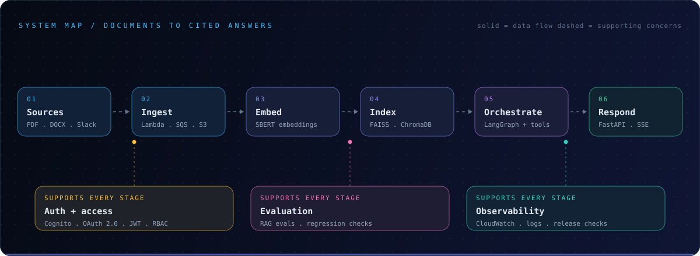

 

  

<a href="#-about">About</a> &nbsp;·&nbsp;
<a href="#-how-i-build">How I build</a> &nbsp;·&nbsp;
<a href="#-featured-projects">Projects</a> &nbsp;·&nbsp;
<a href="#-currently-building">Building</a> &nbsp;·&nbsp;
<a href="#-tech-stack">Stack</a> &nbsp;·&nbsp;
<a href="#-experience">Experience</a> &nbsp;·&nbsp;
<a href="#-github-activity">Activity</a>

## ⚡ About

I'm **Aditya**, an **AI/ML & Cloud Engineer** in **Hyderabad, India**, working as a **Junior AI Cloud Engineer**. I build LLM applications that **retrieve knowledge, use tools, and plug into real workflows**: AI-powered features, authenticated serverless APIs, and enterprise knowledge-source integrations.

I work across the full path, from **chunking and embeddings** to **agent orchestration**, **streaming APIs** and **deployment troubleshooting**. Outside work I build in the open: local-first agents, text-to-app experiments and accessible model fine-tuning.

<table>
<tr>
<td width="33%" valign="top">

**🔎 Retrieve** 
Document ingestion, semantic search, and answers grounded in source material.

</td>
<td width="33%" valign="top">

**🧠 Orchestrate** 
Agent workflows, tool calling, structured outputs and streaming responses.

</td>
<td width="33%" valign="top">

**🚀 Ship** 
Serverless APIs, authenticated integrations, infrastructure as code and monitoring.

</td>
</tr>
</table>

## 🧩 How I build

<b>The engineering decisions I care about</b>

 

| Boundary | Technical focus |
| :--- | :--- |
| **Knowledge → context** | Chunking, embeddings, similarity search, and preserving source metadata for citations. |
| **Model → application** | Tool calling, structured output parsing, provider integration, and streamed responses. |
| **Integration → cloud** | OAuth connection flows, Cognito sessions, authenticated APIs, and Lambda/SQS/S3 ingestion. |
| **Code → operation** | SAM/CloudFormation deployment troubleshooting, CloudWatch monitoring, and release checks. |
| **Model → adaptation** | PEFT/LoRA experiments for small models, with CPU-based local training and chat. |

## 🔧 Featured projects

| Project | What it does | Stack |
| :--- | :--- | :--- |
| **[ALD-01](https://github.com/aditya4232/ALD-01)** | Local-first AI agent system: **5 specialized agents**, **10+ LLM providers** with failover, streaming dashboard. On npm and PyPI. |  |
| **[CodeGenesis](https://github.com/aditya4232/CodeGenesis)** | Multi-agent text-to-app platform that generates full-stack code from natural-language prompts. |  |
| **[FineTuneLite](https://github.com/aditya4232/FineTuneLite)** | Fine-tuning studio for **small language models**: CPU-only PEFT/LoRA training and chat, no GPU or cloud. |  |
| **[Intelligent Document System](https://github.com/aditya4232/Intelligent-document-system)** | RAG Q&A for consulting and staffing workflows, with source citations and confidence scores. |  |
| **[JEV-feedbackchat](https://github.com/aditya4232/JEV-feedbackchat)** | Reusable Python middleware that classifies chat messages, returns structured feedback and adapts the instructions an agent generator consumes. |  |
| **[DYSC-Agent](https://github.com/aditya4232/DYSC-Agent)** | Security-analysis CLI: static analysis plus AI-assisted fixes in an interactive tool-calling REPL. |  |
| **[SafeBite](https://github.com/aditya4232/SafeBite-V1)** | Food-analysis platform: Gemini nutrition insights, OCR label scanning, Firebase auth, real-time sync. |  |

<a href="https://github.com/aditya4232?tab=repositories">All repositories →</a>

## 🔭 Currently building

> Early-stage, design phase.

| Project | The idea |
| :--- | :--- |
| **[agent-workspace](https://github.com/aditya4232/agent-workspace)** | Agentic chat you can inspect: bring your own model, trace every tool call, delete your data. |
| **[agent-labs](https://github.com/aditya4232/agent-labs)** | Reproducible experiments on agent reliability and safety: Trace Lab, Break My Agent, RAG vs Memory. |
| **[clemo](https://github.com/aditya4232/clemo)** | Small, free, browser-first tools that each do one thing well. |

## 🧰 Tech stack

**Languages** 

**Backend & data** 

**AI / ML** 
 

**Cloud & DevOps** 

**Tools** 

## 💼 Experience

<table>
<tr>
<td width="170" valign="top"><b>Junior AI Cloud Engineer</b> Sep 2026 → Present</td>
<td>

- Deploy AI-powered features on AWS; implement Cognito sessions, OAuth integrations and authenticated serverless APIs.
- Build Slack connection flows and history ingestion with **Lambda, SQS and S3**.
- Troubleshoot **SAM/CloudFormation** deployments, monitor health in **CloudWatch**, maintain release checks and technical docs.

</td>
</tr>
<tr>
<td valign="top"><b>AI Engineer Intern</b> Jan 2026 → Jun 2026</td>
<td>

- Built a RAG chatbot over **100+ enterprise documents** (LangChain, Ollama, FAISS/ChromaDB, FastAPI) with source-cited answers.
- Developed document-processing workflows and **Talent Radar**, a candidate-matching dashboard.
- Integrated LLM providers with structured output parsing and streaming responses.

</td>
</tr>
<tr>
<td valign="top"><b>Full Stack Developer Intern</b> Jul 2025 → Sep 2025</td>
<td>

- Built an operations dashboard on **Node.js and MongoDB** with offline field workflows via Service Workers.
- Implemented multi-user auth, **RBAC** and real-time data sync.

</td>
</tr>
</table>

<b>Earlier experience, education & certifications</b>

 

**Software Engineering Intern** · Apr 2025 → Jun 2025 — enterprise HRMS APIs with VB.NET and SQL Server, query optimization, bulk CSV/Excel processing.

**B.Tech, Computer Science Engineering** · ICFAI Foundation for Higher Education, Hyderabad · Jul 2022 – 2026

`Google AI Essentials 2026` `AWS Machine Learning Foundations 2025` `AWS Cloud 101 2025` `Intro to Kubernetes (LFS158) 2025` `Smart India Hackathon 2024` `ISRO Space Technology Training 2024`

## 📈 GitHub activity

<picture>
  <source media="(prefers-color-scheme: dark)" srcset="https://raw.githubusercontent.com/aditya4232/aditya4232/output/github-snake-dark.svg" />
  <source media="(prefers-color-scheme: light)" srcset="https://raw.githubusercontent.com/aditya4232/aditya4232/output/github-snake.svg" />
  
</picture>

**Let's build useful AI, from retrieval to deployment.**

<a href="https://linkedin.com/in/adityashenvi">LinkedIn</a> · <a href="https://adityacuz.in">Portfolio</a> · <a href="mailto:adityashenvi2050@gmail.com">Email</a>

