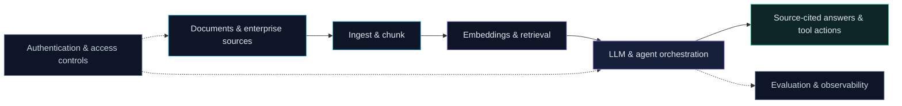

<!-- Profile content refreshed from the October 2026 resume. -->
<p align="center">
  
</p>

<p align="center">
  <a href="https://linkedin.com/in/adityashenvi"></a>
  <a href="https://adityacuz.dev"></a>
  <a href="mailto:adityashenvi2050@gmail.com"></a>
</p>

<p align="center"><b>I build LLM applications that retrieve knowledge, use tools, and connect to real workflows.</b><br/>Python at the core. FastAPI at the boundary. AWS in the cloud.</p>

## `01` / The engineer behind the terminal

I'm **Aditya**, an **AI/ML & Cloud Engineer** based in **Hyderabad, India**. At **InnovyQ**, I work on AI-powered features, authenticated serverless APIs, and enterprise knowledge-source integrations. Previously, I built document-grounded AI at **ScriptBees** and an offline-capable operations dashboard at **DRDO**.

My work spans the full path from **chunking and embeddings** to **agent orchestration**, **streaming APIs**, and **deployment troubleshooting**. I also build in the open: local agents, text-to-app experiments, and accessible model fine-tuning.

```python
# My engineering map — areas I work across, not a runnable SDK.
aditya = {
    "now":      "Junior AI Cloud Engineer @ InnovyQ",
    "ai":       ["RAG", "tool calling", "structured outputs", "agent workflows"],
    "cloud":    ["AWS serverless", "event-driven ingestion", "OAuth 2.0 / JWT"],
    "building": "useful intelligence, connected to real systems",
}
```

## `02` / From source to signal



*The systems I enjoy building: grounded retrieval, deliberate tool use, and observable cloud services.*

## `03` / Selected builds

| Project | What I built | Engineering focus |
| :--- | :--- | :--- |
| **[ALD-01](https://github.com/aditya4232/ALD-01)** | Local AI agent system with **5 specialized agents**, **10+ LLM integrations**, provider failover, and a streaming dashboard. Published on npm and PyPI. | `Python` `FastAPI` `Ollama` `LangChain` |
| **[CodeGenesis](https://github.com/aditya4232/CodeGenesis)** | Multi-agent text-to-app platform that generates full-stack application code from natural-language prompts. | `LangChain` `LangGraph` `OpenRouter` `FastAPI` |
| **[FineTuneLite](https://github.com/aditya4232/FineTuneLite)** | Local fine-tuning studio for **small language models**, with CPU-based PEFT/LoRA training and chat. | `Python` `PEFT` `LoRA` `Transformers` |
| **[Intelligent Document System](https://github.com/aditya4232/Intelligent-document-system)** | Document Q&A for consulting and staffing workflows, with source citations and confidence scores. | `RAG` `Embeddings` `Document Q&A` |
| **[DYSC-Agent](https://github.com/aditya4232/DYSC-Agent)** | Security analysis CLI combining static analysis, AI-assisted fix suggestions, and an interactive tool-calling REPL. | `Node.js` `CLI` `Static analysis` |
| **[SafeBite](https://github.com/aditya4232/SafeBite-V1)** | Food-analysis platform with Gemini nutrition insights, OCR label scanning, Firebase authentication, and real-time sync. | `Flask` `Node.js` `MongoDB` `Firebase` |

<p align="right"><a href="https://github.com/aditya4232?tab=repositories">Explore all repositories →</a></p>

## `04` / Engineering toolkit

| Layer | Tools & concepts |
| :--- | :--- |
| **Intelligence** | LangChain · LangGraph · CrewAI · RAG · MCP · tool calling · structured outputs · RAG evaluation |
| **Models & data science** | PyTorch · scikit-learn · Hugging Face Transformers · SentenceTransformers · PEFT/LoRA · Ollama · Pandas · NumPy |
| **Services & data** | Python · FastAPI · Flask · Node.js · REST · WebSockets · PostgreSQL · MongoDB · SQL Server · FAISS · ChromaDB |
| **AWS** | Lambda · S3 · EC2 · Cognito · Amplify · SQS · CloudWatch · SAM · CloudFormation |
| **Delivery & security** | GitHub Actions · CI/CD · Docker · infrastructure as code · OAuth 2.0 · JWT · RBAC |
| **Also in the toolkit** | Java · JavaScript · Git · Postman · npm · PyPI · GCP & Kubernetes fundamentals |

## `05` / Experience log

**Junior AI Cloud Engineer · InnovyQ**<br/>
`Sep 2026 → Present`

- Deploy AI-powered features on AWS and implement Cognito sessions, OAuth integrations, and authenticated serverless APIs.
- Implement Slack connection flows and support history ingestion with **Lambda, SQS, and S3**.
- Troubleshoot **SAM/CloudFormation** deployments, monitor runtime health in **CloudWatch**, and maintain release checks and technical documentation.

**AI Engineer Intern · ScriptBees Pvt Ltd**<br/>
`Jan 2026 → Jun 2026`

- Built a RAG chatbot over **100+ enterprise documents** using LangChain, Ollama, FAISS/ChromaDB, and FastAPI, with source-cited answers.
- Developed document-processing workflows and **Talent Radar**, a candidate-matching dashboard.
- Integrated LLM providers with structured output parsing and streaming responses.

**Full Stack Developer Intern · DRDO, Ministry of Defence**<br/>
`Jul 2025 → Sep 2025`

- Built an IOD operations dashboard with **Node.js and MongoDB**, supporting offline field workflows through Service Workers.
- Implemented multi-user authentication, **RBAC**, and real-time data synchronization.

<details>
<summary><b>Earlier experience</b></summary>

**Software Engineering Intern · Vestrics Solutions** · `Apr 2025 → Jun 2025`<br/>
Built enterprise HRMS APIs with VB.NET and SQL Server; worked on query optimization and bulk CSV/Excel processing.

</details>

## `06` / Foundations & milestones

**B.Tech · Computer Science Engineering**<br/>
ICFAI Foundation for Higher Education, Hyderabad · **Jul 2022 – Sep 2026**

- **Google AI Essentials** · 2026
- **AWS Machine Learning Foundations** · 2025
- **AWS Cloud 101** · 2025
- **Introduction to Kubernetes (LFS158)** · Linux Foundation · 2025
- **Smart India Hackathon 2024** · National Certificate
- **ISRO Space Technology Training** · 2024

---

<p align="center"><code>Curious about the model. Serious about the system.</code><br/><br/>
<a href="https://linkedin.com/in/adityashenvi">LinkedIn</a> · <a href="https://adityacuz.dev">Portfolio</a> · <a href="mailto:adityashenvi2050@gmail.com">Let's build something useful</a></p>
